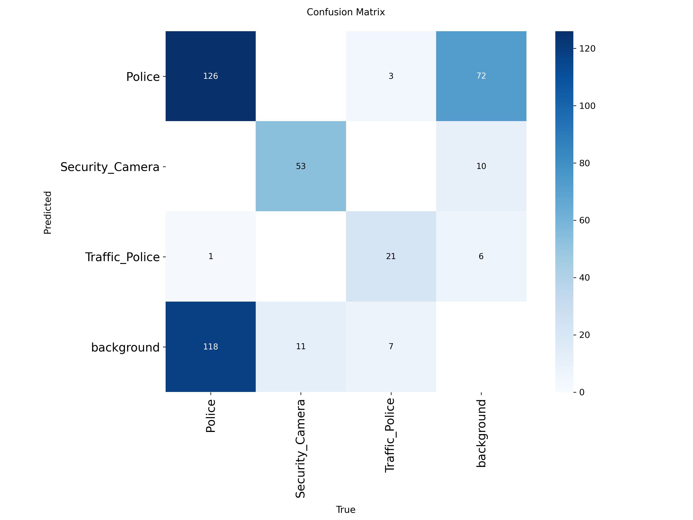

# Police, Traffic Police and Security Camera Detection using YOLOv8

# Idea
I built a computer vision system that detects Police, Traffic Police and Security Cameras in images and videos. The goal is to identify these objects automatically in surveillance and traffic monitoring settings.

The model does not yet reach 90% performance. The main reasons are the small dataset and the difficulty of annotation. With a much larger dataset, it could become far more reliable in the future. It can also be run on a live camera feed.

The aim of this project is to demonstrate the idea and to make these challenges easier to solve in the future.

# Dataset
460 images were collected by myself and manually annotated with bounding boxes on Roboflow
3 classes: Police, Traffic_Police, Security_Camera
Split: 322 train, 92 validation and 46 test images (roughly 70/20/10)
Preprocessing: Auto-Orient and resize to 640×640
Augmentation: flip, rotation (±15°) and saturation (±25%), applied only to the training set. This increased the training images to about 966

[Dataset Link In Roboflow](https://app.roboflow.com/muhammad-farhan-e52jw)

# Comparison of Different Epochs
	Precision	Recall	mAP50	mAP50-95
50 epochs	0.731	0.780	0.752	0.578
100 epochs	0.715	0.735	0.714	0.560

The 50-epoch model performs better, especially in recall. Training for 100 epochs brought no improvement. Instead, the model started to show signs of overfitting.

# Visualization

# Final Model

The 50-epoch model was selected because it gave better results and needed less training time.

Future Improvements
Train the model on a much larger dataset
Try a larger model (YOLOv8s)
Run the model on a live camera feed in real time